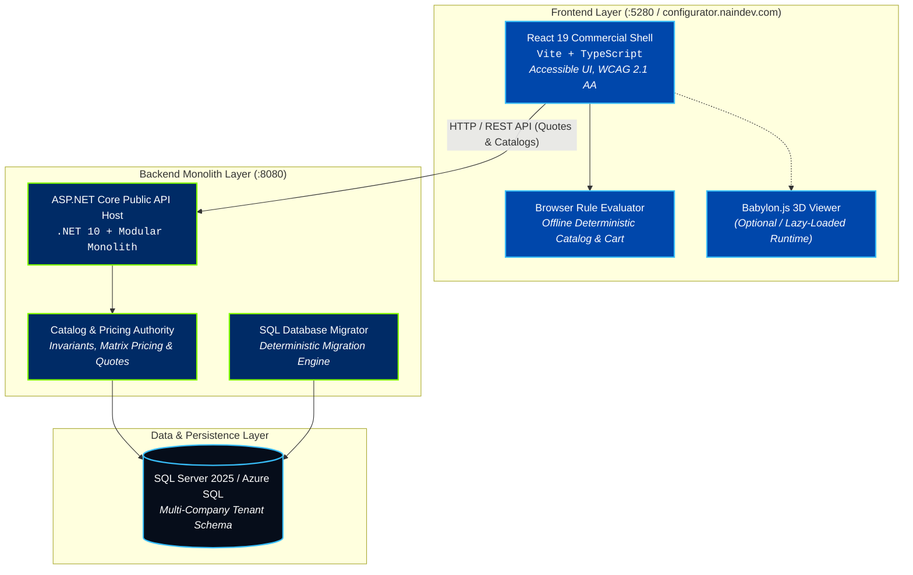

<picture>
  <source media="(prefers-color-scheme: dark)" srcset="docs/assets/banner-dark.svg">
  <source media="(prefers-color-scheme: light)" srcset="docs/assets/banner-light.svg">
  
</picture>

<div align="center">

[](https://configurator.naindev.com/)
[](https://dotnet.microsoft.com/)
[](https://react.dev/)
[](https://www.typescriptlang.org/)
[](https://configurator.naindev.com/)
[](backend)

</div>

**Demo Online Interactiva:** [https://configurator.naindev.com/](https://configurator.naindev.com/) (Motor de compatibilidad y catálogo determinista en navegador, coste 0,00 €)

NainConfigurator is a catalog-driven B2B product configurator designed to support fundamentally different products without customer-specific code, API contracts, database columns or deployment forks.

---

## Architecture Overview



---

Current phase: SL-000 is complete. SL-001 through SL-006 and SL-008 are implemented with automated evidence; optional SL-007 is deferred. The authorized SL-009 candidate passes its clean-checkout automated gate and now awaits the two manual gates documented below. SL-010 and later slices, cloud deployment, public exposure, real personal data, paid services, future commits and push remain unauthorized.

## Product direction

- Shared multi-company SaaS with strict company isolation.
- ASP.NET Core modular monolith for authoritative validation, pricing and persistence.
- React and TypeScript for the accessible commercial shell.
- Babylon.js for an optional lazy-loaded Web renderer.
- Blender for offline 3D asset authoring.
- Sanitized and validated glTF/GLB 2.0 packages for browser delivery.
- SQL Server 2025 Developer for local physical verification and Azure SQL Database as the future paying-customer authority.
- Complete configuration, save and quote flows when 3D is unavailable.

## Free-first boundary

The local prototype and controlled client demo target zero incremental software and cloud cost by using owned hardware, synthetic data and free/open-source tools.

This does not promise zero-cost production. A paying-customer environment may require billable hosting, independent security assessment, backups, support and legal/operational work. No paid resource, trial with automatic renewal or consumption billing may be activated without explicit owner authorization.

## Repository map

| Path | Responsibility | Current state |
|---|---|---|
| `docs/Proyectos Documentación/NainConfigurator` | Canonical product and technical documentation | Active |
| `backend` | .NET modular monolith, public API, domain authority and SQL persistence | Technical Demo candidate |
| `web` | Accessible catalog-driven React commercial shell | Technical Demo candidate |
| `renderer` | Future Babylon.js adapter and browser 3D runtime | Documentation placeholder |
| `database` | Versioned SQL Server migration and synthetic product catalogs | Technical Demo candidate |
| `tests` | Cross-stack verification and source-to-test traceability | Technical Demo candidate |
| `assets` | Future controlled source/published 3D asset pipeline | Documentation placeholder |
| `ops` | LocalDemo packaging, integrity, reset, start, smoke and recovery | Technical Demo candidate |
| `eng` | Reproducible local tools, quality gates and dependency evidence | Active |

## Canonical entrypoints

- [Project overview](<docs/Proyectos Documentación/NainConfigurator/00-ProjectOverview.md>)
- [Documentation roadmap](<docs/Proyectos Documentación/NainConfigurator/00.1-DocumentationRoadmap.md>)
- [Architecture](<docs/Proyectos Documentación/NainConfigurator/06-Architecture.md>)
- [Decision log](<docs/Proyectos Documentación/NainConfigurator/07-DecisionLog.md>)
- [Approved testing strategy](<docs/Proyectos Documentación/NainConfigurator/08-TestingStrategy.md>)
- [Approved deployment and operations](<docs/Proyectos Documentación/NainConfigurator/09-DeploymentAndOperations.md>)
- [Approved implementation plan](<docs/Proyectos Documentación/NainConfigurator/10-ImplementationPlan.md>)
- [Passing implementation-readiness review](<docs/Proyectos Documentación/NainConfigurator/11-ImplementationReadinessReview.md>)
- [Repository navigation context](<docs/Proyectos Documentación/NainConfigurator/00.3-RepositoryContext.md>)

Historical or superseded documents are context only and must not direct implementation.

## Current gates

1. Complete the manual screen-reader check and a clean controlled-machine offline run before declaring `Technical demo ready`.
2. Preserve the passing clean-checkout evidence for the authorized candidate and rerun it after any source change.
3. Keep cloud resources, public exposure, real data, paid services, future commits, pushes and deployment behind their separate explicit permissions.
4. Satisfy the documented PublicDemo, pilot and commercial-launch artifacts only when those later stages are requested.

Technical-demo implementation does not authorize SL-010 or later code, cloud infrastructure, public exposure, real data, paid services, commits, pushes or deployment.

## Technical Demo verification

The full local gate intentionally recreates only the allowlisted synthetic Integration and Demo databases:

```powershell
.\eng\scripts\Invoke-TechnicalDemoQuality.ps1 -ConfirmSyntheticDatabaseReset
```

The generated attended-demo package and runbook are under the ignored `artifacts\release\sl-009-localdemo` directory. SQL Server Developer is valid for development, testing and demonstration, not paying-customer production.

## Repository safety

- Never commit credentials, tokens, personal data, customer documents or production exports.
- Use synthetic data for local development, tests and demos.
- Record ownership and commercial-use rights for every model, texture, font, HDRI and add-on.
- Keep generated output and local editor state out of version control.
- Use Git LFS only after asset size and free-tier limits are reviewed.
- GitHub is an off-device copy and collaboration system, not the only backup.

## Ownership

Private commercial project owned by Nain9Dev. No license to use, copy or distribute the project source or documentation is granted by repository access alone. Third-party components retain their own licenses.
