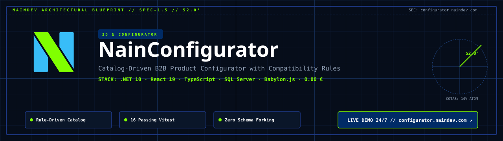
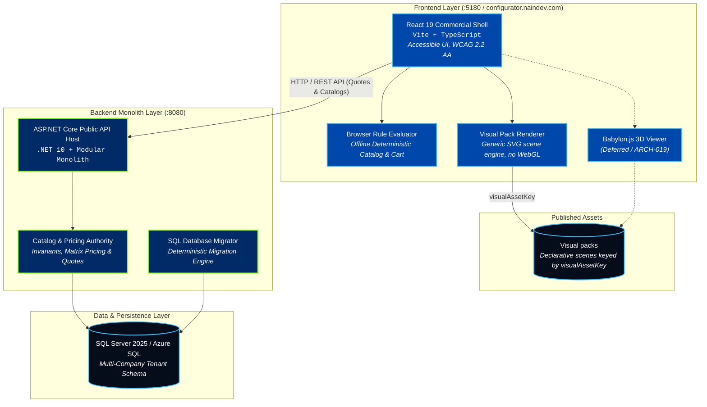

<picture>
  <source media="(prefers-color-scheme: dark)" srcset="docs/assets/banner-dark.svg">
  <source media="(prefers-color-scheme: light)" srcset="docs/assets/banner-light.svg">
  
</picture>

<div align="center">

[](README.md)
[](README.es.md)
[](backend/tests/NainConfigurator.Architecture.Tests/CleanArchitectureFitnessTests.cs)
[](https://configurator.naindev.com/)
[](https://dotnet.microsoft.com/)
[](https://react.dev/)
[](https://www.typescriptlang.org/)
[](web)
[](web/e2e)
[](web/e2e)
[](LICENSE)

</div>

**Demo online:** [configurator.naindev.com](https://configurator.naindev.com/) — the whole configurator runs in the browser against a bundled synthetic catalog. No backend, no database, no cloud resource, 0,00 € of recurring cost.

NainConfigurator is a catalog-driven B2B product configurator designed to support fundamentally different products without customer-specific code, API contracts, database columns or deployment forks.

---

## The problem it solves

A manufacturer selling configurable product usually ends up with one configurator per customer. Every new account adds columns, endpoints and a deployment of its own, so the cost of maintaining the system grows with every sale.

Here, a product is rows. Option groups, selection limits, compatibility rules, prices **and the scene the buyer looks at** are catalog data. The demo ships two unrelated products — a modular desk and an urban bicycle — that share one schema, one public contract, one renderer and one release.

| Usual pattern | This engine |
|---|---|
| A column per customer property | Products, options and rules are rows |
| An endpoint per product | One public contract for every product |
| A branch and a deployment per brand | One deployment, isolated per company |
| Price reimplemented client and server side | The server reprices before anything is saved |
| A preview component per product | One renderer interpreting a published visual pack |

---

## Architecture Overview



The dotted edges are deferred: `ARCH-019` keeps the Babylon.js runtime out of the MVP, and a visual pack is projection-independent, so that adapter can consume the same document when it arrives.

## Catalog-driven visuals

The preview is not a component per product. It is a **visual pack**: a declarative scene document addressed by the product's existing `visualAssetKey`, published under [`assets/visual-packs`](assets/visual-packs) and interpreted by a generic renderer in [`web/src/visual`](web/src/visual) that names no product, company or option.

```jsonc
{
  "vars": { "W": { "base": 120, "when": [{ "key": "DeskTop_160_80", "value": 160 }] } },
  "slots": { "surface": { "base": "oak", "when": [{ "key": "Material_Desk_DarkWalnut", "material": "walnut" }] } },
  "parts": [
    { "id": "top", "shape": "box", "material": "slot:surface",
      "at": ["0", "H - T/2", "0"], "size": ["W", "T", "D"] },
    { "id": "pedestal-left", "shape": "box", "material": "slot:surface",
      "when": ["Drawer_Left"], "at": ["-(W/2 - 24)", "(H - T + 20)/2", "0"],
      "size": ["40", "H - T - 20", "D - 12"] }
  ]
}
```

The only input is the set of `visualAssetKey` values the catalog already carries on the product and on each selected option. Geometry uses three primitives (`box`, `tube`, `ring`); numbers are arithmetic over the pack's own variables, evaluated by a closed parser that cannot resolve anything the pack did not declare.

- No WebGL context, no binary asset, no request beyond the pack itself.
- No change to the public API contract, the database schema or any migration.
- A missing or malformed pack degrades to the accessible fallback view; the commercial flow never depends on it.
- The visual never takes part in validation, pricing or persistence.

See `ARCH-020` in the [decision log](<docs/Proyectos Documentación/NainConfigurator/07-DecisionLog.md>) and [`specs/001-catalog-driven-visualization`](specs/001-catalog-driven-visualization).

---

Current phase: SL-000 is complete. SL-001 through SL-006 and SL-008 are implemented with automated evidence; optional SL-007 is deferred. The authorized SL-009 candidate passes its clean-checkout automated gate and now awaits the two manual gates documented below. SL-010 and later slices, cloud deployment, public exposure, real personal data, paid services, future commits and push remain unauthorized.

## Product direction

- Shared multi-company SaaS with strict company isolation.
- ASP.NET Core modular monolith for authoritative validation, pricing and persistence.
- React and TypeScript for the accessible commercial shell.
- Babylon.js for an optional lazy-loaded Web renderer.
- Blender for offline 3D asset authoring.
- Sanitized and validated glTF/GLB 2.0 packages for browser delivery.
- SQL Server 2025 Developer for local physical verification and Azure SQL Database as the future paying-customer authority.
- Complete configuration, save and quote flows when 3D is unavailable.

## Free-first boundary

The local prototype and controlled client demo target zero incremental software and cloud cost by using owned hardware, synthetic data and free/open-source tools.

This does not promise zero-cost production. A paying-customer environment may require billable hosting, independent security assessment, backups, support and legal/operational work. No paid resource, trial with automatic renewal or consumption billing may be activated without explicit owner authorization.

## Repository map

| Path | Responsibility | Current state |
|---|---|---|
| `docs/Proyectos Documentación/NainConfigurator` | Canonical product and technical documentation | Active |
| `backend` | .NET modular monolith, public API, domain authority and SQL persistence | Technical Demo candidate |
| `web` | Accessible catalog-driven React commercial shell | Technical Demo candidate |
| `renderer` | Future Babylon.js adapter and browser 3D runtime | Documentation placeholder |
| `database` | Versioned SQL Server migration and synthetic product catalogs | Technical Demo candidate |
| `tests` | Cross-stack verification and source-to-test traceability | Technical Demo candidate |
| `assets` | Published visual packs and the future glTF/GLB pipeline | Visual packs active |
| `specs` | Feature specifications, designs and task state | Active |
| `ops` | LocalDemo packaging, integrity, reset, start, smoke and recovery | Technical Demo candidate |
| `eng` | Reproducible local tools, quality gates and dependency evidence | Active |

## Canonical entrypoints

- [Project overview](<docs/Proyectos Documentación/NainConfigurator/00-ProjectOverview.md>)
- [Documentation roadmap](<docs/Proyectos Documentación/NainConfigurator/00.1-DocumentationRoadmap.md>)
- [Architecture](<docs/Proyectos Documentación/NainConfigurator/06-Architecture.md>)
- [Decision log](<docs/Proyectos Documentación/NainConfigurator/07-DecisionLog.md>)
- [Approved testing strategy](<docs/Proyectos Documentación/NainConfigurator/08-TestingStrategy.md>)
- [Approved deployment and operations](<docs/Proyectos Documentación/NainConfigurator/09-DeploymentAndOperations.md>)
- [Approved implementation plan](<docs/Proyectos Documentación/NainConfigurator/10-ImplementationPlan.md>)
- [Passing implementation-readiness review](<docs/Proyectos Documentación/NainConfigurator/11-ImplementationReadinessReview.md>)
- [Repository navigation context](<docs/Proyectos Documentación/NainConfigurator/00.3-RepositoryContext.md>)

Historical or superseded documents are context only and must not direct implementation.

## Current gates

1. Complete the manual screen-reader check and a clean controlled-machine offline run before declaring `Technical demo ready`.
2. Preserve the passing clean-checkout evidence for the authorized candidate and rerun it after any source change.
3. Keep cloud resources, public exposure, real data, paid services, future commits, pushes and deployment behind their separate explicit permissions.
4. Satisfy the documented PublicDemo, pilot and commercial-launch artifacts only when those later stages are requested.

Technical-demo implementation does not authorize SL-010 or later code, cloud infrastructure, public exposure, real data, paid services, commits, pushes or deployment.

## Technical Demo verification

The full local gate intentionally recreates only the allowlisted synthetic Integration and Demo databases:

```powershell
.\eng\scripts\Invoke-TechnicalDemoQuality.ps1 -ConfirmSyntheticDatabaseReset
```

The generated attended-demo package and runbook are under the ignored `artifacts\release\sl-009-localdemo` directory. SQL Server Developer is valid for development, testing and demonstration, not paying-customer production.

## Repository safety

- Never commit credentials, tokens, personal data, customer documents or production exports.
- Use synthetic data for local development, tests and demos.
- Record ownership and commercial-use rights for every model, texture, font, HDRI and add-on.
- Keep generated output and local editor state out of version control.
- Use Git LFS only after asset size and free-tier limits are reviewed.
- GitHub is an off-device copy and collaboration system, not the only backup.

## Running the web demo locally

```bash
cd web
npm ci
npm run start      # http://127.0.0.1:5180, offline catalog, no backend needed
```

```bash
cd web
npm test                  # 83 unit tests
npm run test:e2e:offline  # 20 journeys on Chromium, Firefox, WebKit and mobile Chromium
```

`npm run start` and `npm run build` both run `npm run catalog` first, which projects the SQL seed into the offline catalog and stages every visual pack into `web/public/visual-packs` (generated; the authored source is `assets/visual-packs`).

## Ownership and license

Copyright Nain9Dev. The source and documentation in this repository are published under the **AGPL-3.0-or-later** license in [`LICENSE`](LICENSE); third-party components retain their own licenses. Synthetic demo data is part of the repository and describes no real company, product or person.
