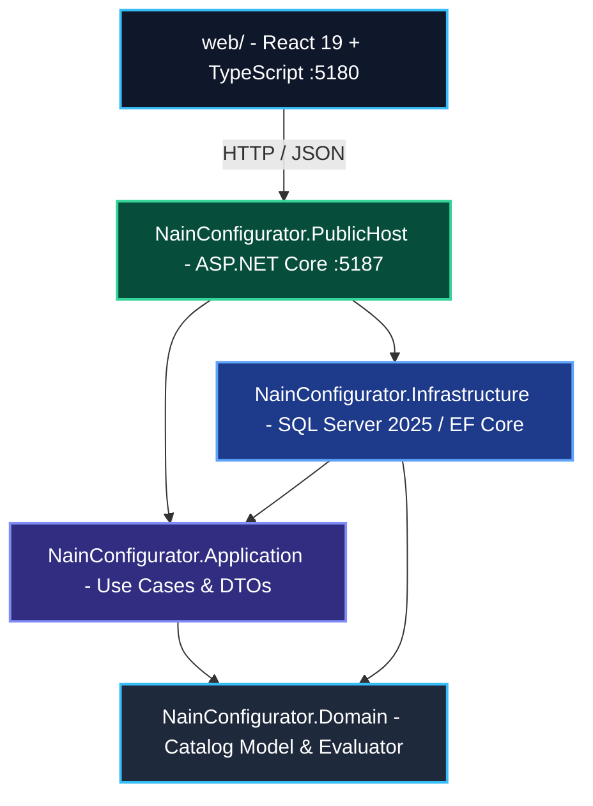

# System Architecture — NainConfigurator

## 1. High-Level System Architecture

NainConfigurator follows **Clean Architecture** boundaries with strict inward dependency rules enforced by `NetArchTest`.

## 2. Layer Taxonomy

| Project | Purpose | Invariant Rules |
| :--- | :--- | :--- |
| **`NainConfigurator.Domain`** | Pure catalog models (`ProductDefinition`, `OptionGroup`, `Option`), rule evaluator (`ConfigurationEvaluator`). | Zero dependencies on outer layers or external databases. |
| **`NainConfigurator.Application`** | Public configurator orchestration (`PublicConfigurator`), visual state canonicalization, persistence interfaces. | Depends only on `Domain`. Never imports `Infrastructure` or web hosts. |
| **`NainConfigurator.Infrastructure`** | Persistence store (`SqlNainConfiguratorStore`), company tenant scope, cryptographic code generation. | Depends on `Application` and `Domain`. Never imports web presentation hosts. |
| **`NainConfigurator.PublicHost`** | ASP.NET Core minimal API endpoints, rate limiting, security headers, and static bundle delivery. | Wires the dependency injection container and routes external HTTP requests. |
| **`NainConfigurator.Architecture.Tests`** | Automated `NetArchTest` suite asserting strict layer isolation and clean architecture rules. | Must remain green on every build. |
| **`web/`** | React 19 client with real-time SVG visual packs, offline catalog fallback, and WCAG 2.2 AA accessibility. | Interacts via standard JSON APIs or embedded offline catalog. |

## 3. Detailed Documentation References

Detailed enterprise specifications, business rules, and technical logs are maintained in:
- `docs/Proyectos Documentación/NainConfigurator/02-BusinessRules.md`: Full catalog constraint algebra.
- `docs/Proyectos Documentación/NainConfigurator/03-DataModel.md`: SQL Server 2025 relational schema.
- `docs/Proyectos Documentación/NainConfigurator/07-DecisionLog.md`: Historical architectural decision log.
